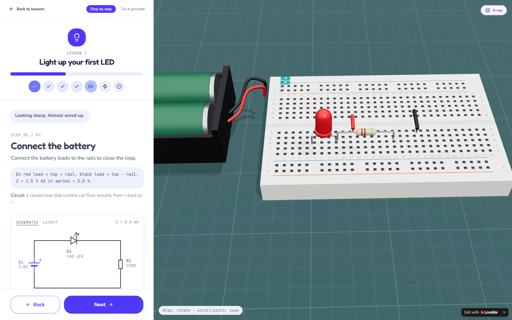
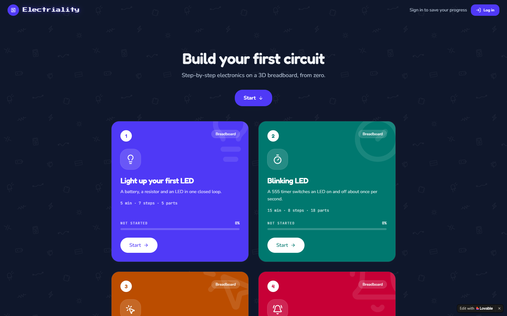
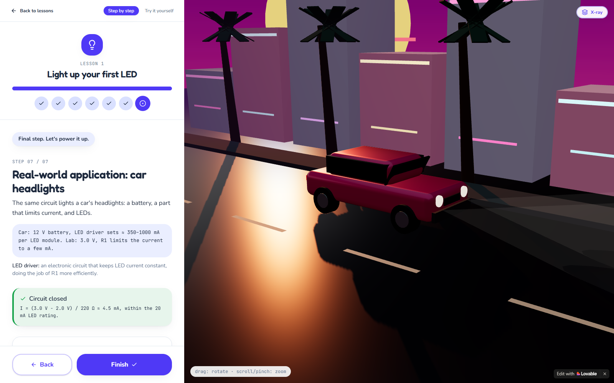
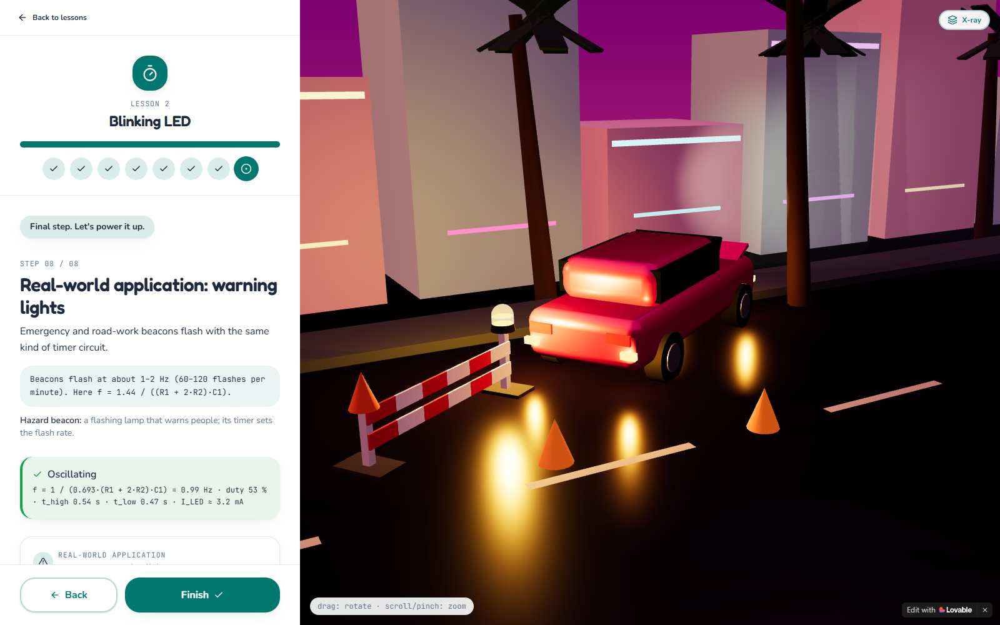
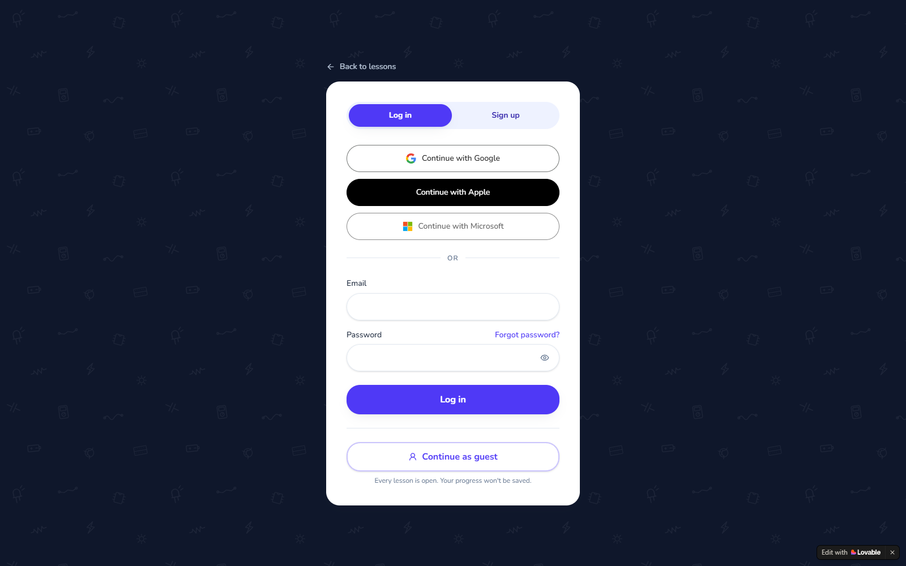

<div align="center">

# Electriality

### Learn electronics by building real circuits in 3D, one step at a time.

## From "what is a breadboard?" to soldering a temperature alarm, in 12 guided projects.

**No kit. No experience. Every hole, value and current is the real one.**

**HackTheTrent 2026**<br>
3D breadboard and stripboard workbench · live schematic and circuit simulation · real-world applications · accounts with saved progress



<sub>Lesson 1, "Light up your first LED": every part goes into an exact hole (LED anode in e10, cathode in e13, R1 from d13 to d20), and the schematic updates as you build.</sub>

<br>

| **12** | **3** | **2** | **4.5 mA** | **88+** |
|:---:|:---:|:---:|:---:|:---:|
| guided projects, each with a BOM, schematic and 6 to 10 steps | levels: Beginner, Intermediate, Advanced | boards: breadboard and stripboard with soldering | real LED current computed live: (3.0 V − 2.0 V) / 220 Ω | automated tests checking holes, joints, nets and values |

[Live demo](https://electriality.lovable.app) · [The problem](#the-problem) · [How it works](#how-it-works) · [Projects](#projects) · [Real-world applications](#real-world-applications) · [Tech stack](#tech-stack) · [Run it locally](#run-it-locally) · [Team](#team)

</div>

---

## The problem

Getting started with electronics is intimidating. Tutorials assume you already know what a rail is, skip why the resistor is there, and a wrong placement on a real breadboard just does nothing, with no explanation. Most people give up before their first LED lights up.

**Electriality turns the first circuits into a guided, visual game that is still technically correct.** You build on a 3D breadboard or stripboard where every lead goes into a real hole, the app checks which holes are actually connected, and every step comes with one plain-language sentence plus one technical detail.

## How it works



1. **Pick a project.** Projects are grouped into Beginner, Intermediate and Advanced, and each card shows the time, steps, parts and your progress.
2. **Meet the parts.** The first step is a bill of materials (Ref, Part, Value, Qty), like a real datasheet.
3. **Build step by step.** Each part animates into its exact hole. The focused holes are highlighted with their ID (e10, H6...), and an **X-ray** view shows the metal strips under the board.
4. **See the circuit.** A **Schematic** tab with standard symbols and a **Layout** tab (breadboard or veroboard plan) highlight the parts of the current step.
5. **Power it up.** A net solver (union-find over the breadboard strips, stripboard tracks, track cuts, wires and closed switches) decides what really happens: the LED lights, the 555 oscillates, the buzzer sounds, or you get a technical warning such as "LED overcurrent: no current-limiting resistor".
6. **Try it yourself.** In free-build mode, mistakes are part of the lesson: a reversed LED stays off (reverse biased), a missing resistor burns it.

### Soldering, safely

Stripboard lessons start with a **Safety and setup** step that brings the tools onto the bench in 3D: soldering iron in its stand with a wet sponge and brass wool, **fume extractor** with spinning blades, safety glasses, flux pen, helping hands, side cutters, desoldering pump and a multimeter. Then the technique: heat pad and lead together for 2 to 3 s, feed the solder into the joint, check for bridges, test continuity before applying power. Solder joints are generated on the copper side exactly under each soldered lead.

## Projects

| Level | Project | Board | What you learn |
|---|---|---|---|
| Beginner | **Light up your first LED** | Breadboard | Closed loop, current limiting, I = (V − Vf) / R |
| Beginner | **Blinking LED** | Breadboard | TLC555 astable, f = 1.44 / ((R1 + 2·R2)·C1) ≈ 0.99 Hz, live scope trace |
| Beginner | **Push-button light** | Breadboard | Momentary, normally open switch |
| Beginner | **Buzzer alarm** | Breadboard | Active piezo buzzer, polarity |
| Intermediate | **Night light** | Breadboard | LDR voltage divider, transistor as a switch |
| Intermediate | **RC fade** | Breadboard | Capacitor discharge, time constant τ = R·C |
| Intermediate | **First soldered circuit** | Stripboard · soldering | Safety, soldering technique, continuity test |
| Intermediate | **5 V regulated supply** | Stripboard · soldering | LM7805, dropout, measuring with a multimeter |
| Advanced | **PWM motor speed control** | Breadboard | 555 PWM, logic-level MOSFET, flyback diode |
| Advanced | **LM386 audio amplifier** | Stripboard · soldering | Gain, coupling and Zobel network, 8 Ω speaker |
| Advanced | **LED chaser** | Breadboard | 555 clock into a CD4017 decade counter |
| Advanced | **Temperature alarm** | Stripboard · soldering | LM35 sensor, LM358 comparator, threshold |

## Real-world applications

The last step of each Beginner project swaps the breadboard for a 3D scene that shows the same circuit in real life, with the calculation and a lab-vs-real comparison.

<p>


</p>

- **Car headlights** (P-01): an R1 slider changes the LED current and the headlights' brightness.
- **Warning lights** (P-02): a road-work beacon and hazard lights flash at the real 555 timing; an R2 slider changes the rate.
- **Interior light** (P-03): hold the button to light a car's cabin at night.
- **Car alarm** (P-04): activate the alarm and the intruder runs away.

## Accounts and progress



Sign up with email (with live password rules) or continue as a guest. Signed-in learners keep their progress per lesson in Supabase, protected by row-level security; guests keep it in the browser and can sync it into an account later.

## Tech stack

- **App:** TanStack Start, React, TypeScript, Tailwind CSS, shadcn/ui
- **3D:** three.js with React Three Fiber and drei
- **Circuit engine:** net solver and behaviour models (series DC, 555 astable, switches, buzzers) in plain TypeScript
- **Backend:** Supabase via Lovable Cloud (auth and saved progress)
- **Tests:** Vitest, with checks that every lead is in a valid hole, every solder joint sits on its lead, no part floats, no supply is shorted and the solved nets match each schematic
- **Built with:** [Lovable](https://lovable.dev)

## Run it locally

You need Node.js (or Bun).

```sh
git clone https://github.com/santiagoalvarezv/HackTheTrent.git
cd HackTheTrent
npm install
npm run dev
```

```sh
npm test        # run the test suite
npm run build   # production build
```

The `.env` file only holds the public Supabase URL and publishable key used by the web app.

## Team

Built at **HackTheTrent 2026** by team **AI (Asian Intelligence)**:

- **Santiago Alvarez:** projects and circuits
- **Neli:** design and frontend
- **Bailasan:** real-world applications
